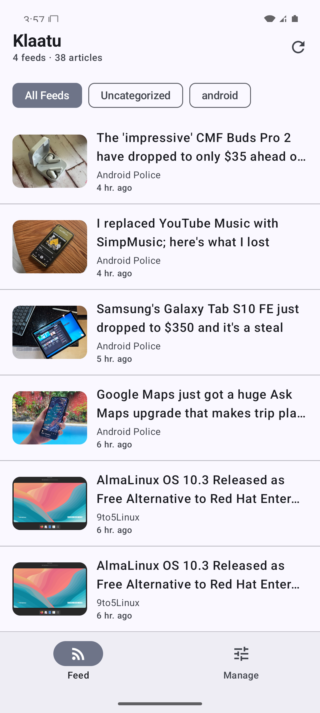
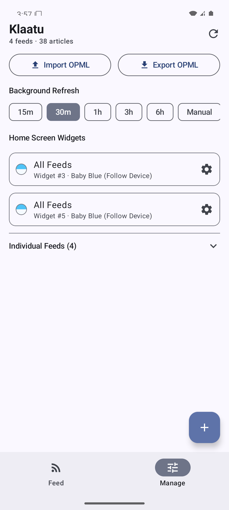

# Klaatu

A modern, widget-first Android RSS/Atom feed reader built in **Kotlin**, inspired by the classic Palabre scrollable home screen widget.

## Screenshots

| Home Screen Widget | In-App Feed Reader | Configure Widget | Manage & OPML |
| :---: | :---: | :---: | :---: |
|  |  |  |  |

## Features
- **Scrollable Home Screen Widget** (Jetpack Glance):
  - Rounded card container with a themed header bar (Gort badge, widget label + article count, spinning refresh button, settings gear).
  - Compact yet readable article rows: rounded thumbnail on the left, 2-line title, and feed name + relative timestamp on the right.
  - Tapping any article opens it directly in your default browser.
  - **Multiple independent widgets**: Each home screen widget can have its own OPML folders, individual feeds (including mix-and-match across folders), custom header label, and color theme ([WidgetConfigActivity](app/src/main/java/com/klaatu/rss/widget/WidgetConfigActivity.kt)).
  - **10 Material-inspired color themes**: *Baby Blue*, *Light Orange*, *Yellow*, *Purple*, *Pink*, *Coral Red*, *Green*, *Mint Teal*, *Periwinkle*, and *Monochrome*.
  - **Light / Dark & Header Styles**: Supports **Follow Device**, **Light**, and **Dark** appearance modes, plus **Vibrant** and **Soft Pastel** light header styles.
- **OPML Support**: Import and export feed subscriptions and folders/categories via standard OPML 2.0 XML ([OpmlCodec](app/src/main/java/com/klaatu/rss/data/opml/OpmlCodec.kt)), with case-insensitive attribute handling and folder updates on re-import.
- **RSS 2.0 & Atom Sync**: Parallel feed fetching (`Semaphore(8)`) with automatic `http://` → `https://` URL upgrades, Room caching, and Coil thumbnail loading.
- **In-App RSS Reader** (Jetpack Compose + Material 3, with OS Light/Dark & Material You Dynamic Color via [KlaatuTheme](app/src/main/java/com/klaatu/rss/ui/theme/KlaatuTheme.kt)):
  - **Feed** tab: browse stories with thumbnails, filter by OPML folder, pull-to-refresh, and tap any story to open it in your default browser.
  - **Manage** tab: import/export OPML, configure background refresh frequency (`15m`, `30m`, `1h`, `3h`, `6h`, `Manual`), view/configure placed widgets, and manage individual feeds.
- **Adaptive & Monochrome App Icon**: Gort-inspired black-and-white vector icon with Material You themed-icon support.
- **CI & Releases**: GitHub Actions workflow ([release.yml](.github/workflows/release.yml)) runs unit tests on every push/PR and builds & publishes signed APKs on `v*` tags.

## Tech Stack
- **Language**: Kotlin (`2.0.21`)
- **Widget**: Jetpack Glance (`glance-appwidget`, `glance-material3`)
- **App UI**: Jetpack Compose + Material 3
- **Persistence**: Room (SQLite + KSP)
- **Background Sync**: WorkManager
- **Networking & Parsing**: OkHttp + `javax.xml.parsers` DOM (`OpmlCodec`, `FeedParser`)
- **Image Loading**: Coil

## Development Environment Setup
Configured for local builds on Linux (Fedora) using user-space tools:
- **JDK**: Eclipse Temurin JDK 21 (`~/.local/jdks/jdk-21`)
- **Android SDK**: `~/Android/Sdk` (`cmdline-tools`, `platform-tools`, `emulator`, `platforms;android-35`, `build-tools;35.0.0`, `system-images;android-35;google_apis;x86_64`)
- **AVD**: `klaatu_pixel` (Pixel 7, Android 15 / API 35)
- **Environment variables** (added to `~/.zshrc`):
  ```bash
  export JAVA_HOME="$HOME/.local/jdks/jdk-21"
  export ANDROID_HOME="$HOME/Android/Sdk"
  export PATH="$JAVA_HOME/bin:$ANDROID_HOME/cmdline-tools/latest/bin:$ANDROID_HOME/emulator:$ANDROID_HOME/platform-tools:$PATH"
  ```

### Building & Testing
```bash
./gradlew testDebugUnitTest
./gradlew assembleDebug
./gradlew installDebug
```

### Decision Log
See [DECISIONS.md](DECISIONS.md) for architecture and tooling decisions.
